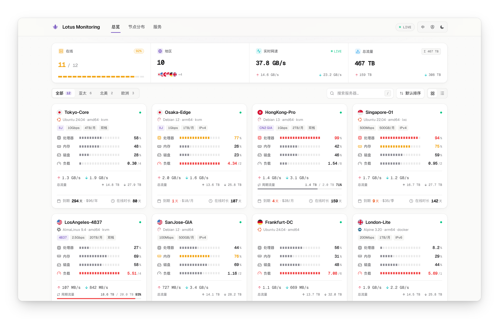
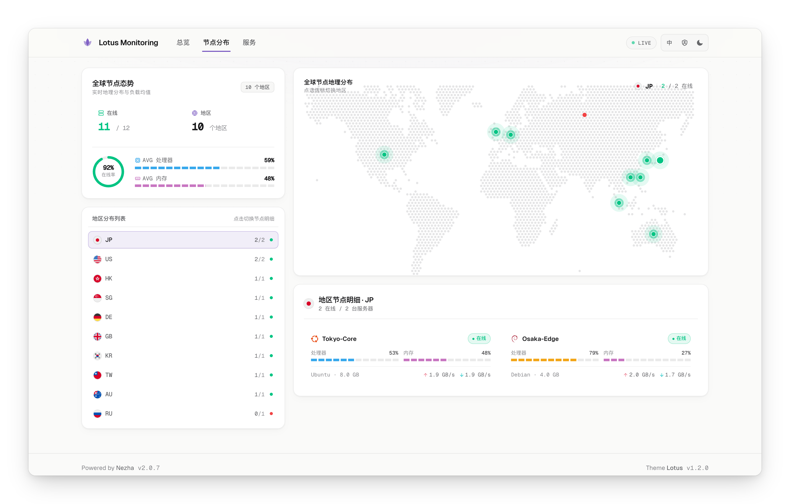
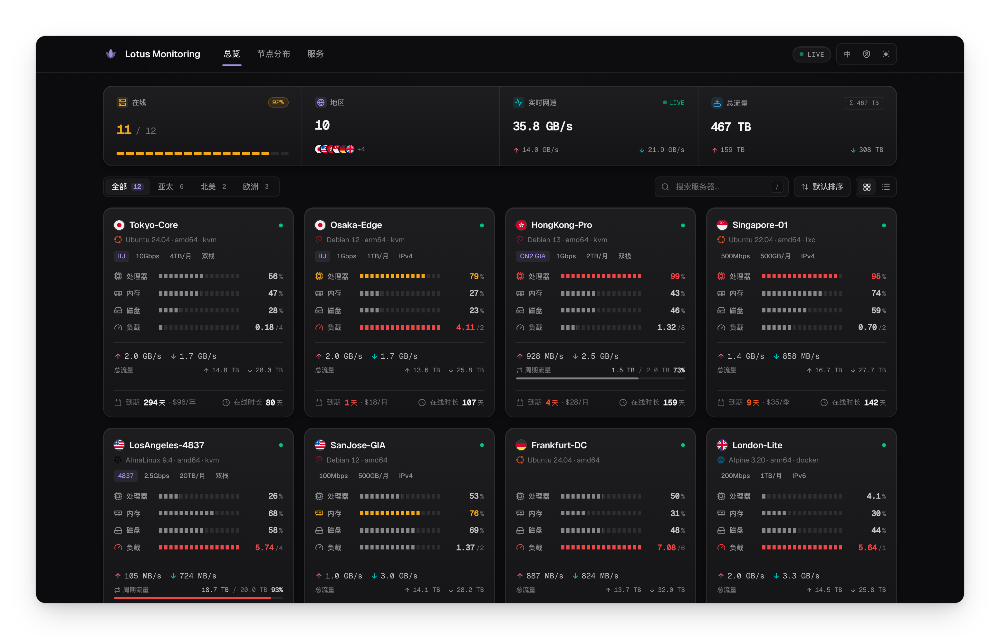
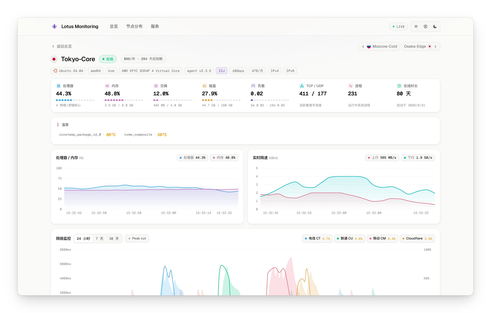
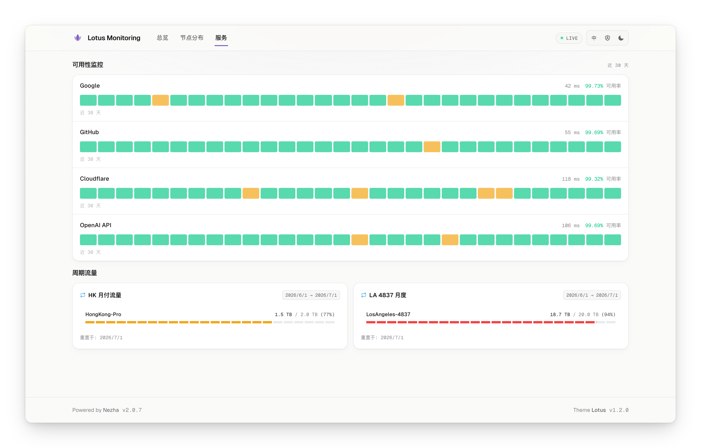

<div align="center">

# 🪷 Lotus

**哪吒监控主题** · 跟随系统 · 玻璃质感 · 克制色彩

为 [哪吒监控](https://github.com/nezhahq/nezha) **v2**（v2.5.0+）打造的用户前端主题

[](https://github.com/fl0w1nd/Lotus/actions/workflows/ci.yml)
[](https://github.com/fl0w1nd/Lotus/releases)
[](https://react.dev)
[](https://www.typescriptlang.org)
[](https://tailwindcss.com)
[](https://vitejs.dev)

</div>

> 名字取自哪吒的莲花化身 —— 莲（Lotus）。

设计语言取法 Vercel / Linear / Apple：跟随系统深浅色、玻璃质感卡片、等宽数字排版、克制的色彩——让色彩只承载信息（在线 / 告警 / 离线），其余交给灰阶与留白。




<details>
<summary>📷 更多预览（暗色 / 详情页 / 服务页）</summary>





</details>

---

## ✨ 特性

- **节点分布页** — 独立导航标签，左侧 HUD 面板（在线率环形图、地区统计、平均 CPU / 内存条）+ 右侧 Stripe 风格点阵世界地图（构建期生成，运行时零依赖），点击国家展开服务器详情卡片
- **实时总览** — WebSocket 实时流（`/api/v1/ws/server`），聚合统计条（在线数 / 地区 / 实时网速 / 总流量）带数字滚动动画
- **服务器卡片 / 列表** — 卡片与列表双视图，一键切换（持久化偏好）；卡片模式展示 OS 发行版图标（simple-icons）、CPU / 内存 / 磁盘渐变进度（75% 变琥珀、90% 变红）、实时网速 + 流量、迷你网速曲线图；列表模式紧凑五行布局
- **分组 / 搜索 / 排序** — 服务器分组过滤、模糊搜索、按 CPU / 内存 / 流量 / 在线时长排序
- **服务器详情** — 主机信息芯片（含虚拟化类型）、实时指标瓦片、GPU 利用率 + 显存（多卡，显存需面板 v2.3.9+ / Agent v2.3.5+）、温度传感器条、负载相对核心数着色、CPU + 内存 / 网络实时曲线、TCP / TCPing 网络监控多线图（可逐线开关 + Peak Cut 峰值裁剪）
- **TSDB 历史指标** — v2 新增 `/api/v1/server/{id}/metrics`，支持 CPU / 内存 / 磁盘 / 上下行 / 负载 / 进程 / 连接 8 种指标（有 GPU 的机器额外提供 GPU 利用率），24h / 7d / 30d 切换；`tsdb_enabled: false` 时自动隐藏
- **服务页** — 30 天可用性方块图（Vercel status 风格）+ 周期流量统计进度
- **账单与套餐** — 解析 `public_note` 中的计费数据（与 nezha-dash 约定兼容），六级到期色阶指示（已到期 / ≤3 天脉冲红 → ≤30 天灰阶）、流量用量进度条、套餐标签（带宽 / 流量 / IPv4 / IPv6 / 线路）
- **自定义代码注入** — 管理后台「自定义代码」中的 CSS / JS 会被注入页面，所有官方变量可用
- **健康感知 favicon** — 浏览器标签图标随整体健康状态变色（正常紫 / 有离线琥珀 / 大面积故障红）
- **断线提示** — WebSocket 断开超 3 秒显示顶部重连提示条
- **暗 / 亮主题** — 默认跟随系统，可手动切换（系统 → 浅色 → 深色三态循环），支持 `window.ForceTheme` 强制；`theme-color` 与 `<html lang>` 动态同步
- **中 / 英双语** — 跟随浏览器语言与面板 `language` 配置，可手动切换
- **可访问性** — 全局键盘焦点环、WCAG 对比度校准、移动端完整适配、入场动画尊重 `prefers-reduced-motion`

---

## 🚀 部署

> [!IMPORTANT]
> Lotus v1.2.0 起需要哪吒面板 **v2.5.0+**。面板版本更低时请使用 [Lotus v1.1.0](https://github.com/fl0w1nd/Lotus/tree/v1.1.0#readme)，并按该版本的说明部署。

部署分两步：先在面板里安装主题，再配置反向代理。已经配好反代的话，只需要第一步。

### 第一步：安装主题

在面板后台的「前端管理」里一键安装，不需要挂载目录，也不需要重启面板：

1. 以管理员身份进入 **设置 → 前端管理**，选择 **用户前端**
2. 仓库地址填写 `https://github.com/fl0w1nd/Lotus`，点击 **读取发布版本**
3. 选择最新版本，点击 **安装**，完成后点击 **启用**

> [!TIP]
> **升级**：在同一页面安装新版本并启用。旧版本不会自动删除，切换后可以在列表里手动删除。
>
> **换回官方主题**：在列表中启用内置的 `Official`（`user-dist`）。

> [!NOTE]
> 安装的主题保存在面板配置文件同目录的 `frontends/` 下。Docker 部署需要持久化这个目录，官方 compose 挂载的 `./data:/dashboard/data` 已经包含它。

<details>
<summary>📦 离线环境：手动挂载 <code>user-dist</code></summary>

<br>

面板无法访问 GitHub 时，可以手动下载主题并放到面板的 `user-dist` 目录。面板会优先读取这个目录，覆盖内嵌的官方主题。

下载并解压，得到 `dist/` 目录：

```bash
wget https://github.com/fl0w1nd/Lotus/releases/latest/download/dist.zip
unzip dist.zip
```

**Docker**：把 `dist/` 挂载到容器的 `/dashboard/user-dist`。

```yaml
# docker-compose.yml
services:
  dashboard:
    image: ghcr.io/nezhahq/nezha:latest
    volumes:
      - ./data:/dashboard/data
      - ./dist:/dashboard/user-dist:ro   # ← 挂载主题
    ports:
      - 8008:8008
```

**二进制**（一键脚本安装，默认路径 `/opt/nezha/dashboard/`）：

```bash
sudo rm -rf /opt/nezha/dashboard/user-dist
sudo cp -r dist /opt/nezha/dashboard/user-dist
sudo systemctl restart nezha-dashboard
```

**注意：**

- 「前端管理」中启用的用户前端必须是内置的 `Official`（`user-dist`），否则挂载的目录不会生效。
- 更新时用新版 `dist/` **整体替换**旧目录，然后重启面板。只覆盖文件会残留旧版本的资源文件。

</details>

### 第二步：配置反向代理

反向代理负责 HTTPS、Agent 的 gRPC 连接和页面的 WebSocket 实时数据。Lotus 对反代没有额外要求，与[官方文档](https://nezha.wiki/guide/q3.html)一致。

下面是反代直接面向公网时的配置，把域名、证书路径换成自己的即可。

<details open>
<summary><b>Nginx</b></summary>

<br>

```nginx
server {
    listen 443 ssl;
    listen [::]:443 ssl;
    http2 on;   # Agent 的 gRPC 需要 HTTP/2；Nginx 1.25.1 以下改为 listen 443 ssl http2;
    server_name status.example.com;

    ssl_certificate     /path/to/fullchain.pem;
    ssl_certificate_key /path/to/privkey.pem;

    # Agent gRPC
    location ^~ /proto.NezhaService/ {
        grpc_pass grpc://127.0.0.1:8008;
        grpc_set_header Host $host;
        grpc_set_header nz-realip $remote_addr;
        grpc_read_timeout 600s;
        grpc_send_timeout 600s;
        grpc_socket_keepalive on;
        grpc_buffer_size 4m;
        client_max_body_size 10m;
    }

    # WebSocket：实时数据、网页终端、文件管理
    location ~* ^/api/v1/ws/(server|terminal|file)(.*)$ {
        proxy_pass http://127.0.0.1:8008;
        proxy_http_version 1.1;
        proxy_set_header Host $host;
        proxy_set_header nz-realip $remote_addr;
        proxy_set_header Origin https://$host;
        proxy_set_header Upgrade $http_upgrade;
        proxy_set_header Connection "upgrade";
        proxy_read_timeout 3600s;
        proxy_send_timeout 3600s;
    }

    # 页面与 API
    location / {
        proxy_pass http://127.0.0.1:8008;
        proxy_set_header Host $host;
        proxy_set_header nz-realip $remote_addr;
        proxy_set_header X-Forwarded-Proto $scheme;
        proxy_read_timeout 3600s;
        proxy_send_timeout 3600s;
        proxy_max_temp_file_size 0;
    }
}
```

</details>

<details>
<summary><b>Caddy</b></summary>

<br>

Caddy 会自动申请证书，WebSocket 也会自动处理。

```caddyfile
status.example.com {
    # Agent gRPC
    @grpc path /proto.NezhaService/*
    handle @grpc {
        reverse_proxy h2c://127.0.0.1:8008 {
            header_up Host {host}
            header_up nz-realip {remote_host}
        }
    }

    # 页面、API 与 WebSocket
    handle {
        reverse_proxy 127.0.0.1:8008 {
            header_up Host {host}
            header_up Origin https://{host}
            header_up nz-realip {remote_host}
        }
    }
}
```

</details>

> [!TIP]
> **套了 CDN（如 Cloudflare）**：`nz-realip` 要改成 CDN 传来的真实 IP 请求头，否则面板记录的都是 CDN 节点的 IP。
>
> - Nginx：把 `$remote_addr` 换成 `$http_cf_connecting_ip`
> - Caddy：把 `{remote_host}` 换成 `{http.request.header.CF-Connecting-IP}`
>
> **反代和面板在同一个 Docker Compose 里**：把 `127.0.0.1:8008` 换成面板的服务名和端口，例如 `dashboard:8008`。

<details>
<summary>🌐 进阶：静态文件交给自己的 Web 服务器或 CDN</summary>

<br>

想让静态资源走 CDN 时，可以把 `dist/` 部署到任意静态服务，只把 `/api/v1/` 反代到面板。Lotus 使用 Hash 路由，静态服务不需要做路由回退。

```nginx
server {
    listen 443 ssl;
    http2 on;
    server_name status.example.com;

    root /var/www/lotus-dist;

    # 入口文件每次都重新验证；assets/ 下的文件名带内容 hash，可以长期缓存
    location = /index.html {
        add_header Cache-Control "no-cache";
    }
    location /assets/ {
        add_header Cache-Control "public, max-age=31536000, immutable";
    }

    location /api/v1/ {
        proxy_pass http://127.0.0.1:8008;
        proxy_http_version 1.1;
        proxy_set_header Host $host;
        proxy_set_header nz-realip $remote_addr;
        proxy_set_header Upgrade $http_upgrade;
        proxy_set_header Connection "upgrade";
    }
}
```

**注意**：这只是前台页面的地址。管理后台和 Agent 的 gRPC 仍然需要按上面的方式反代面板本身。

</details>

### 从 v1.1.0 及更早版本升级

<details>
<summary>旧版部署方式与 v1.2.0 的区别</summary>

<br>

1. **面板升级到 v2.5.0+**，然后按[第一步](#第一步安装主题)改用「前端管理」安装。之后可以去掉原来对 `user-dist` 的挂载。
2. **反代配置**：旧版要求剥离 `If-Modified-Since` / `If-None-Match` 请求头，用来绕过面板把 304 改写成 200 导致的白屏。面板 v2.5.0 已修复这个问题，这两行可以删除，保留也不影响使用。
3. **发布包结构**：`dist.zip` 解压后的目录从 `nezha-theme-lotus-dist/` 改为 `dist/`。继续手动挂载的话，注意调整路径。
4. **社区镜像**：旧 README 介绍的社区镜像方案（通过 `NZ_EXTRA_USER_THEME_*` 环境变量加载主题）已移除，请改用「前端管理」。

</details>

---

## ⚙️ 自定义变量

与官方主题保持兼容，在管理后台「自定义代码」中设置：

| 变量 | 说明 |
| --- | --- |
| `window.ForceTheme` | `"light"` / `"dark"` 强制颜色主题 |
| `window.CustomLogo` | 替换左上角 Logo 图片 URL |
| `window.CustomDesc` | 站名旁的描述文本 |
| `window.CustomLinks` | 自定义外链，JSON 字符串，如 `'[{"name":"Blog","link":"https://example.com"}]'` |
| `window.CustomBackgroundImage` | 桌面端背景图 URL |
| `window.CustomMobileBackgroundImage` | 移动端背景图 URL |
| `window.ShowNetTransfer` | 是否在卡片显示累计流量（本主题默认显示，设为 `false` 可隐藏） |
| `window.ForceUseSvgFlag` | 强制使用 SVG 国旗（Windows 平台会自动启用，emoji 国旗在 Windows 不可用） |

---

## 🛠 开发

工具链（Node / pnpm 版本）和常用命令统一由 [mise](https://mise.jdx.dev) 管理，配置见 [`mise.toml`](mise.toml)。

```bash
mise install       # 安装固定版本的 Node 与 pnpm
mise run install   # 按 lockfile 安装依赖
mise run mock      # 终端 1：启动本地 mock 哪吒 v2 后端（REST + WS，端口 8008）
mise run dev       # 终端 2：启动 Vite 开发服务器
```

本地 mock 默认管理员态，可直接测试网络监控 7 天 / 30 天；游客态用
`MOCK_AUTH=guest mise run mock`。

对接真实面板调试（代理转发 API 与 WebSocket）：

```bash
NEZHA_BACKEND=https://your-dashboard.example.com mise run dev
```

构建与打包：

```bash
mise run build     # 类型检查并构建，产物在 dist/
mise run package   # 构建并打包 dist.zip，校验面板「前端管理」要求的结构
```

页脚显示的主题版本在构建时注入：发版时 CI 传入 tag，本地构建取 `git describe` 的结果，也可以用 `LOTUS_VERSION=v1.2.0 mise run build` 手动指定。`mise tasks` 可查看全部任务。

---

## 🧩 技术栈

React 19 · TypeScript · Vite 8 · Tailwind CSS 4 · TanStack Query · Recharts · react-router · NumberFlow · simple-icons · Geist 字体

> 世界地图点阵数据由 `mise run gen:map` 生成（基于 dotted-map），运行时为纯 SVG，零依赖。

## 📡 数据接口

| 接口 | 用途 |
| --- | --- |
| `WS /api/v1/ws/server` | 实时状态流 |
| `GET /api/v1/server-group` | 服务器分组 |
| `GET /api/v1/service` | 服务可用性 + 周期流量 |
| `GET /api/v1/server/{id}/service` | 单机 ping 监控 |
| `GET /api/v1/server/{id}/metrics` | TSDB 历史指标（v2） |
| `GET /api/v1/setting` | 站点配置 / 版本 / tsdb 开关 |

---

## 📄 开源协议

本项目基于 [MIT License](LICENSE) 开源。

```
MIT License

Copyright (c) 2026 fl0w1nd

Permission is hereby granted, free of charge, to any person obtaining a copy
of this software and associated documentation files (the "Software"), to deal
in the Software without restriction, including without limitation the rights
to use, copy, modify, merge, publish, distribute, sublicense, and/or sell
copies of the Software, and to permit persons to whom the Software is
furnished to do so, subject to the following conditions:

The above copyright notice and this permission notice shall be included in all
copies or substantial portions of the Software.

THE SOFTWARE IS PROVIDED "AS IS", WITHOUT WARRANTY OF ANY KIND, EXPRESS OR
IMPLIED, INCLUDING BUT NOT LIMITED TO THE WARRANTIES OF MERCHANTABILITY,
FITNESS FOR A PARTICULAR PURPOSE AND NONINFRINGEMENT. IN NO EVENT SHALL THE
AUTHORS OR COPYRIGHT HOLDERS BE LIABLE FOR ANY CLAIM, DAMAGES OR OTHER
LIABILITY, WHETHER IN AN ACTION OF CONTRACT, TORT OR OTHERWISE, ARISING FROM,
OUT OF OR IN CONNECTION WITH THE SOFTWARE OR THE USE OR OTHER DEALINGS IN THE
SOFTWARE.
```

---

## 🤝 友情链接

- [**Linux.do**](https://linux.do) — 真诚、友善、团结、专业，共建你我引以为荣之社区。
